# FamilyOS design directions: rendered screens

Rendered from the built prototype (`design/prototype`) with Playwright, at **1440 × 900** (desktop)
and **390 × 844** (phone). All data is invented. The interactive prototype is one self-contained
file: [`design/FamilyOS-design-directions.html`](../FamilyOS-design-directions.html) (download and
open in any browser).

**Chosen 2026-11-15:** direction **C · Family Rhythm**, with the warmth of **A** in the details.
The build plan is in `docs/plan/redesign-family-rhythm.md` on branch `redesign/family-rhythm`.

| | Direction | In one line |
|---|---|---|
| **A** | Family Workspace | A warm, calm family notebook with Things 3 polish. |
| **B** | Command Center | A dense, keyboard-fast desktop app in the spirit of Linear. |
| **C** | Family Rhythm | Each person's day as a lane, with June's whereabouts and every handoff drawn in. |

## Side by side

Each sheet: A, B, C left to right; desktop above, phone below.

### Home
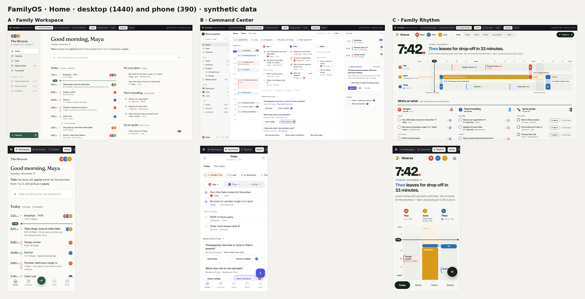

### Weekly Reset
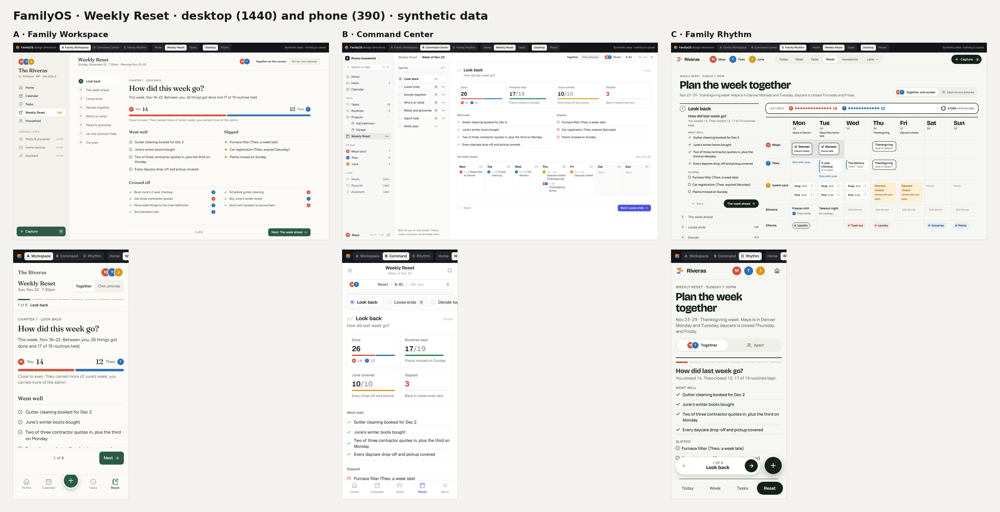

### Tasks
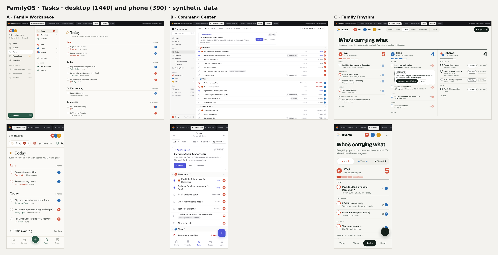

## Every screen at full size

### C · Family Rhythm (chosen)

| Screen | Desktop | Phone |
|---|---|---|
| Home | 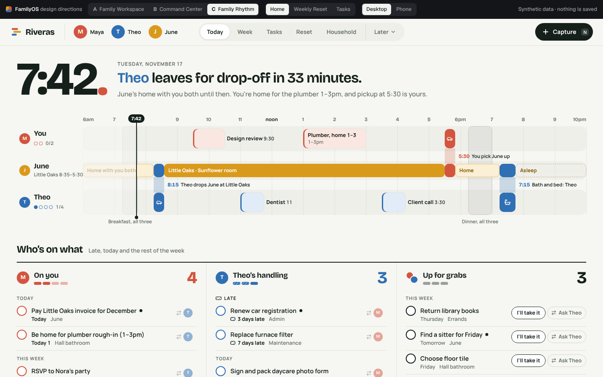 | 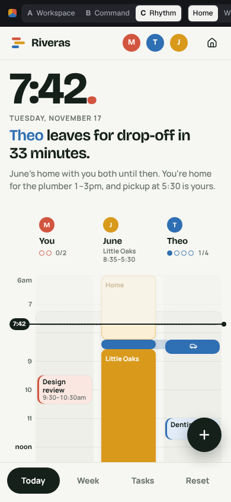 |
| Weekly Reset | 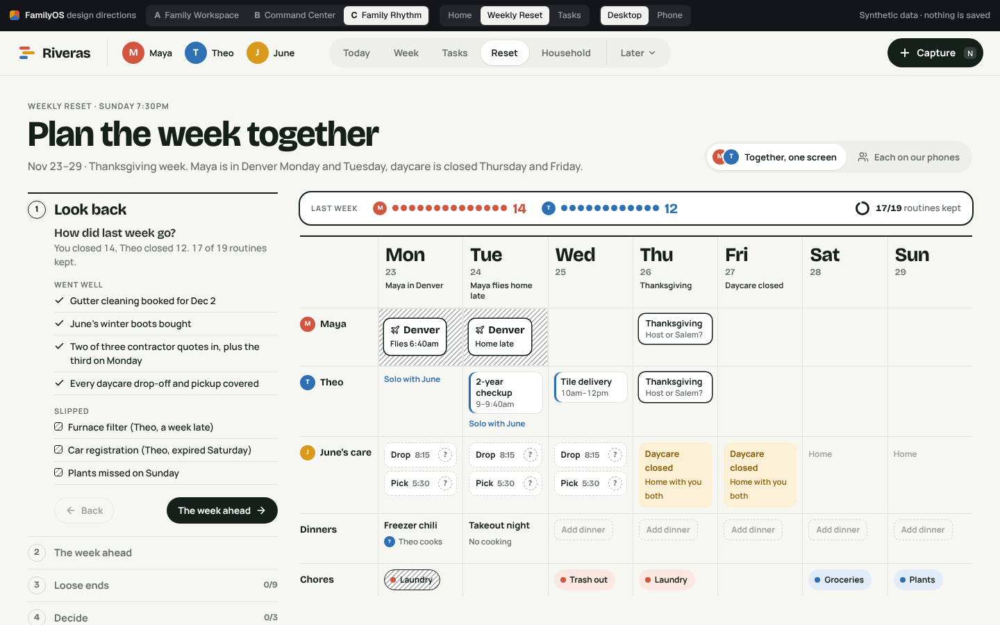 | 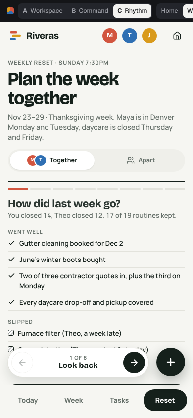 |
| Tasks | 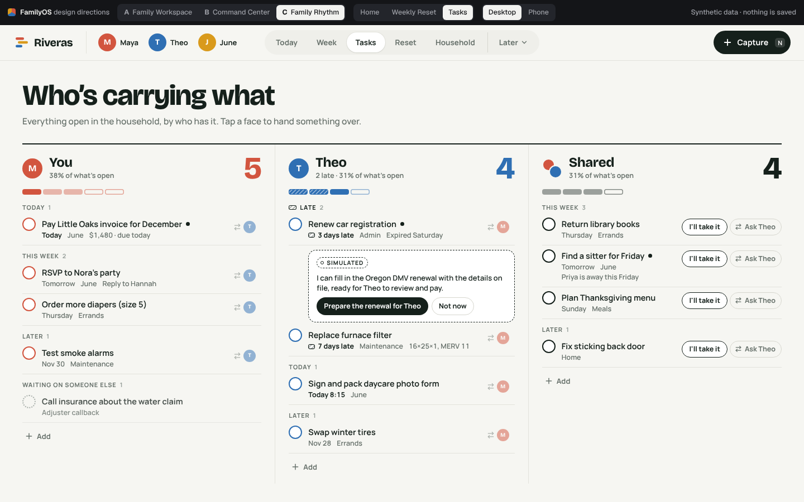 | 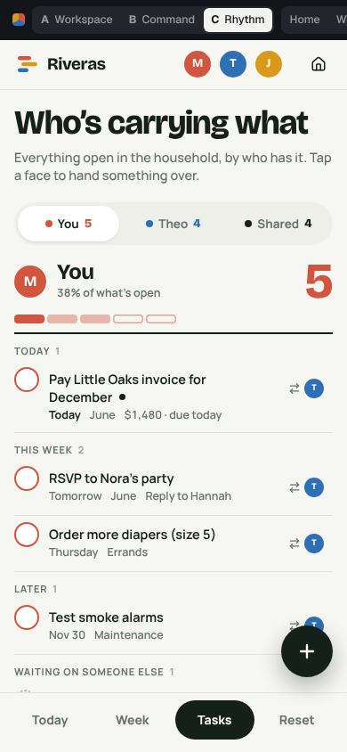 |

### A · Family Workspace

| Screen | Desktop | Phone |
|---|---|---|
| Home | 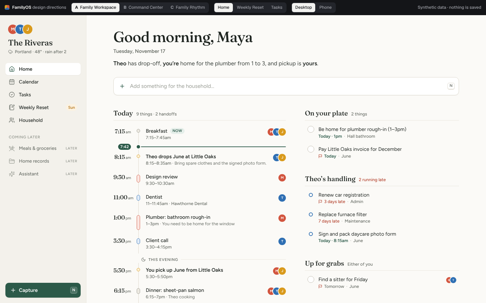 | 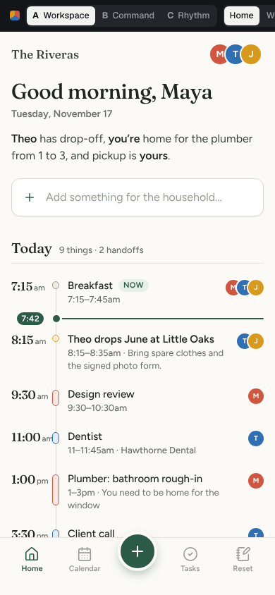 |
| Weekly Reset | 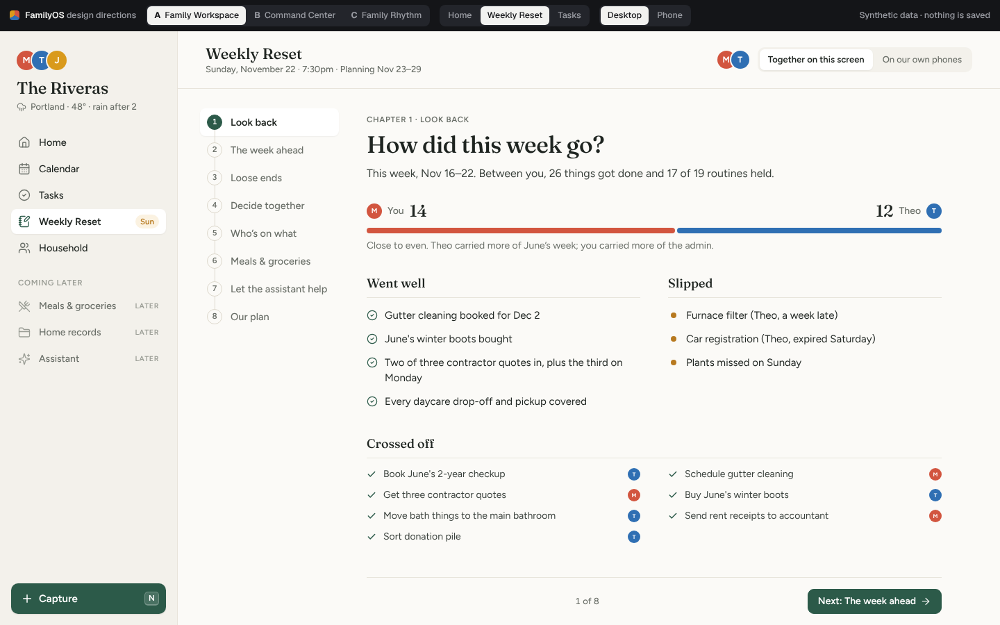 | 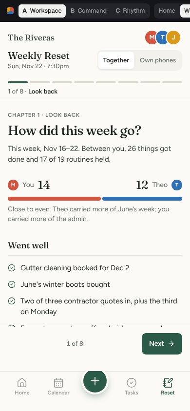 |
| Tasks | 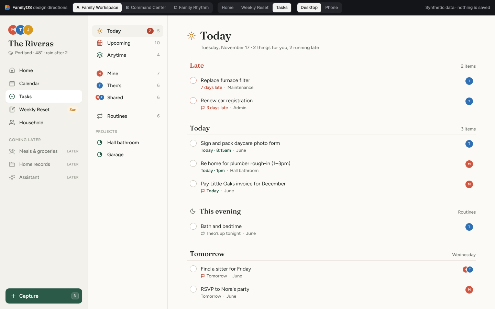 | 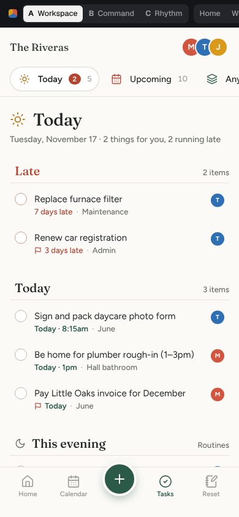 |

### B · Command Center

| Screen | Desktop | Phone |
|---|---|---|
| Home | 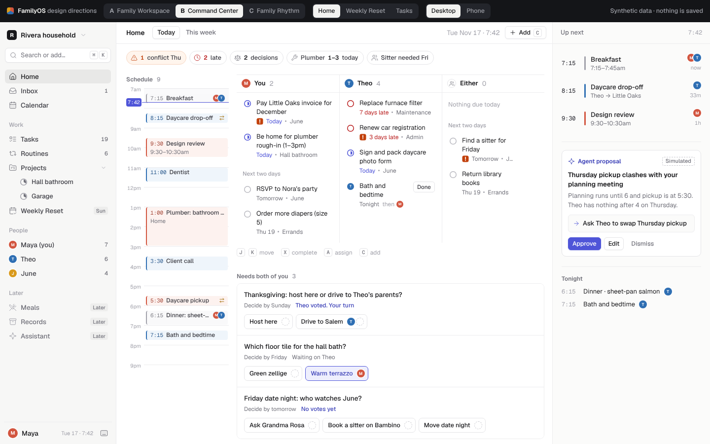 | 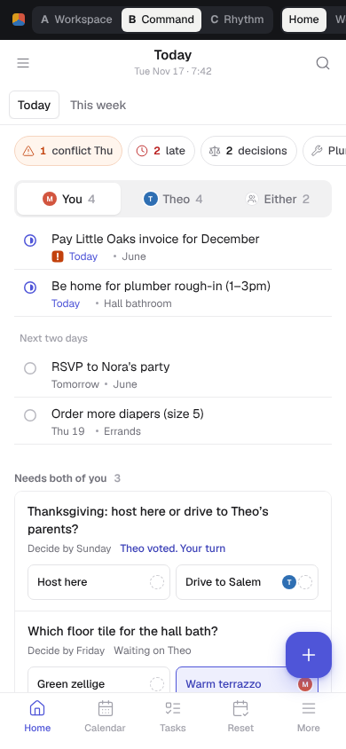 |
| Weekly Reset | 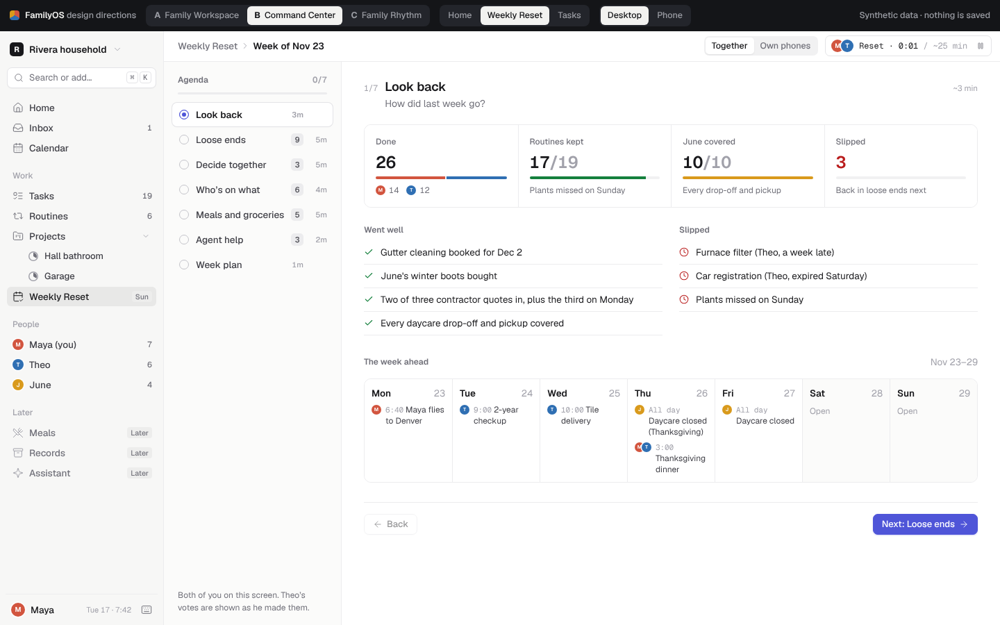 | 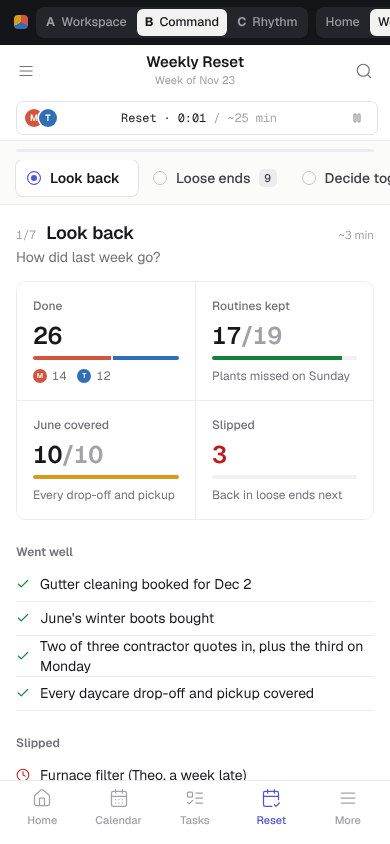 |
| Tasks | 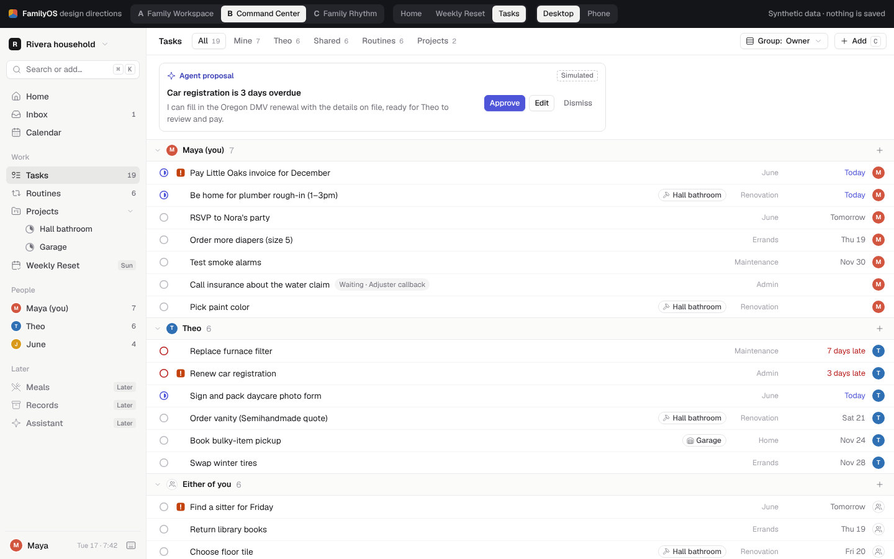 | 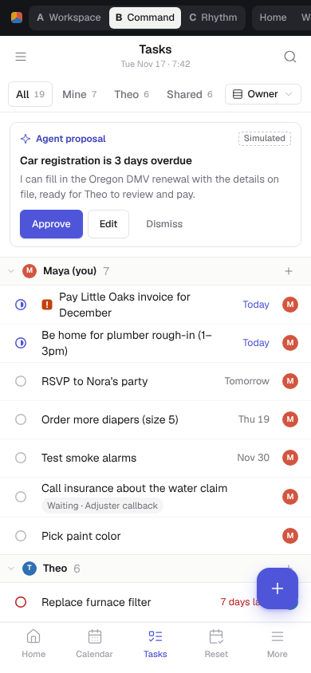 |
